

  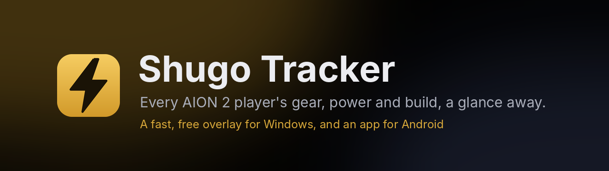

  
  &nbsp;
  
   <a href="https://github.com/CynicaGaming/Shugo-Tracker/releases/latest">Latest release notes</a>

<b>Look anyone up in a second. See exactly what they're wearing. Know who's around you.</b> 
One small, always-on-top window that sits over the game — no browser, no tabbing out. 
And the same lookups in your pocket with the Android app.

  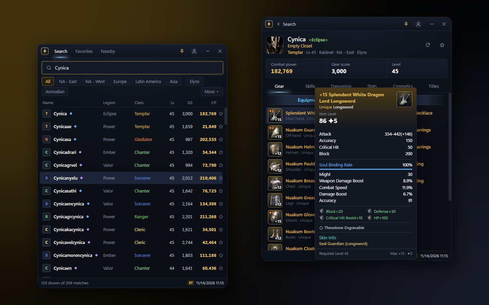

---

## Search

<table>
<tr>
<td width="52%">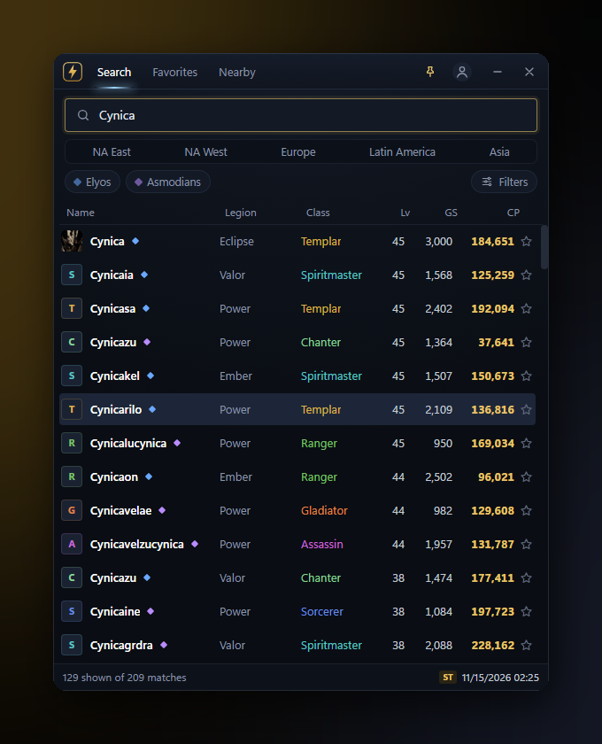</td>
<td>

Type a name and every match across **all five Global regions** shows up while you type — with
**combat power, gear score, class, level, legion and server** right in the list.

- Filter by region, faction, class and level in one click
- Sort by any column; each tab remembers its own sort
- Show, hide and resize columns: drag the line between two headers

</td>
</tr>
</table>

## Character Profiles

<table>
<tr>
<td>

Open a character to see their **gear, skills, Stigma, Daevanion boards, stats, appearance and titles**.

Hover any item for a tooltip laid out like the game's own: stats and enchant bonuses, soul imprint,
**mana stones, theostones**, and for Arcana cards their **linked skills and set bonuses** — with the bonuses
they actually have lit up.

Hold **Alt** over any item to compare it with your active character's: your piece from the same slot opens beside it,
with ▲/▼ on item level and every stat.

Hover a skill for what it does at that character's level, with its cooldown and MP, the numbers that grow with
level in gold like the game. Skill info is provided by <a href="https://metabot.gg/en/aion-2/skills">MetaBot.GG</a>.

</td>
<td width="52%">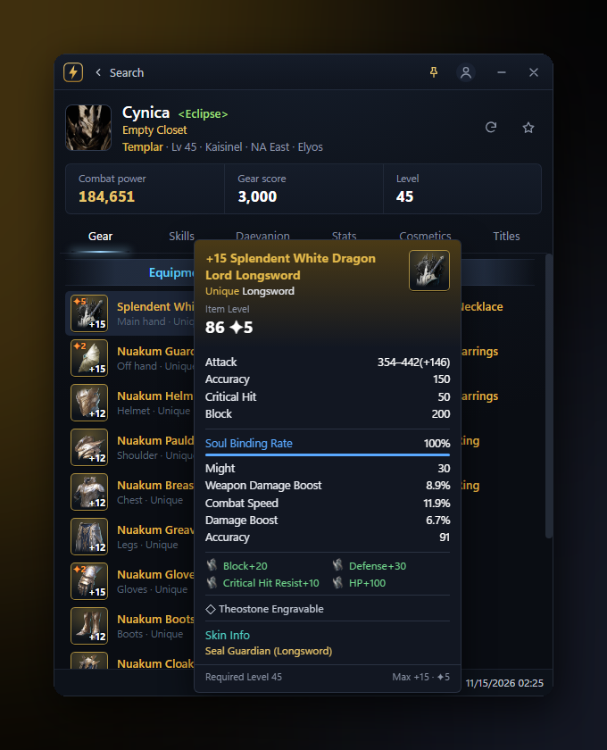</td>
</tr>
</table>

  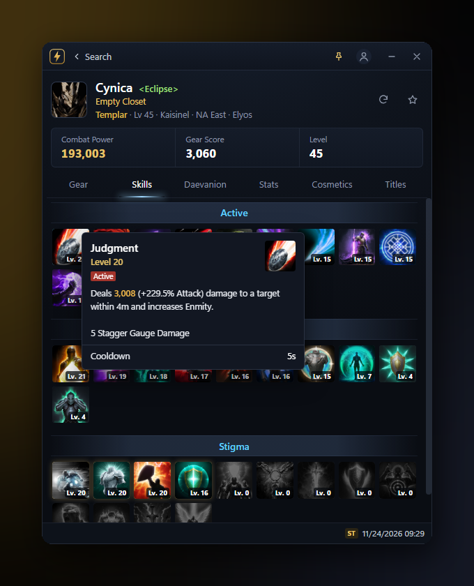
  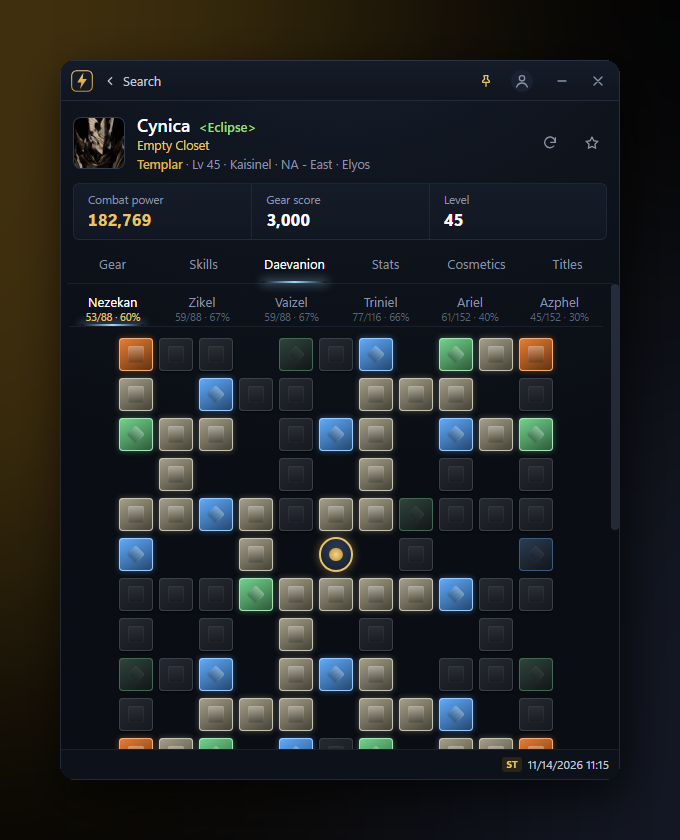

## Nearby

<table>
<tr>
<td width="52%">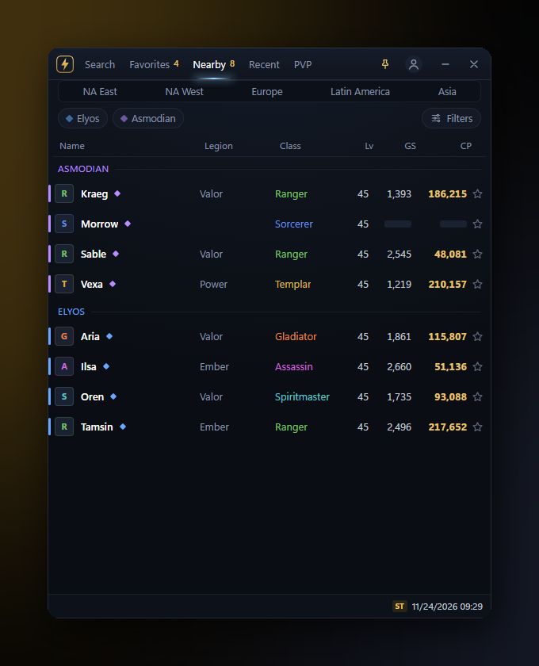</td>
<td>

Turn on **Nearby** and the players around your character appear on their own — enemies and allies,
each with their power and gear score, in towns, in the open world, in Shugo and in the arena.

**Recent** keeps everyone you've crossed paths with — as many as you like — with when you last saw them
and a ⚔ for anyone who fought you.

**PVP** logs who you killed, who killed you, your assists and your duels, with kills, deaths and K/D for any
dates you pick. Click anyone to see every fight you've had with them.

**Pop out** any tab (right-click it) into its own slim window over the game: Nearby and PVP as compact HUDs,
each with its own opacity, click-through and lock. An **Enemy Alert** can play a sound when an enemy shows up.

Opt-in. Reads the game's network traffic on your PC through Windows itself — nothing extra to install. It never sends or changes anything.

</td>
</tr>
</table>

## Android

  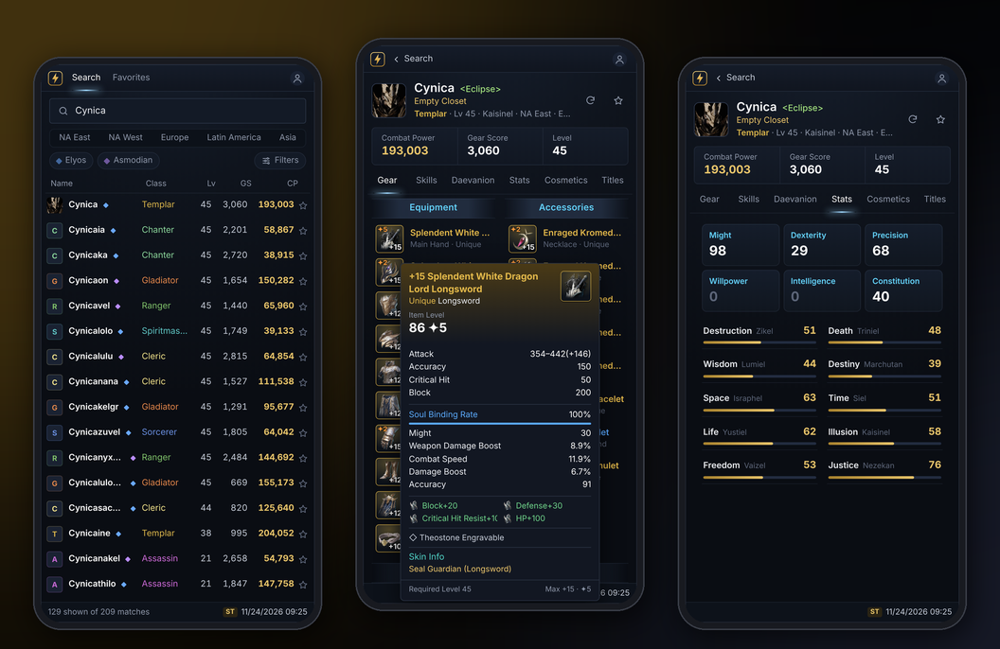

The same search and profiles on your phone: **every region, every tab, the same game-style tooltips** —
tap an item, stat or skill to see it. Favorites and your own characters work just like on the desktop.

It updates itself the same way too: **Download**, then **Install**, from Settings → Updates.

Nearby and PVP need the game running beside them, so they stay on the Windows app.

## Features

<table>
<tr>
<td width="33%" valign="top">

**★ Favorites** 
Star friends, rivals and your legion. Drag them into your own order.

Save up to five of your own characters (right-click → **Set as My Character**) and switch between them from
your name in the top right.

</td>
<td width="33%" valign="top">

**📌 Overlay** 
Borderless, always on top, resizable from any edge, any opacity. Works on any monitor.

</td>
<td width="33%" valign="top">

**⚡ Fast** 
Results stream in as they arrive; people you've met before load instantly.

</td>
</tr>
<tr>
<td valign="top">

**🧳 Portable** 
One exe, nothing to install. It keeps everything in the folder beside it; copy the folder anywhere and everything comes with it.
On Android, one APK.

</td>
<td valign="top">

**⬇ Updates itself** 
A green arrow appears when there's a new version: click to download, click again to restart.

</td>
<td valign="top">

**🔒 Private** 
No account, no sign-in. Character data comes from NCSOFT's public AION 2 site. Anonymous usage statistics
(version, platform, how often features are used; never names or searches) can be turned off in Settings.

</td>
</tr>
</table>

  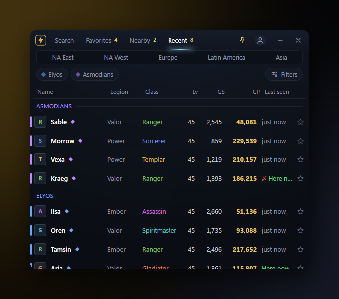
  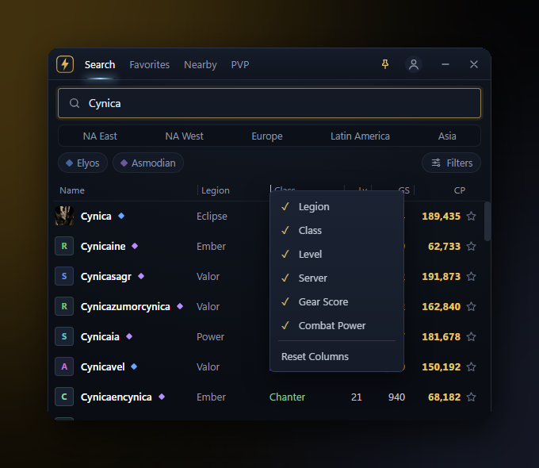
  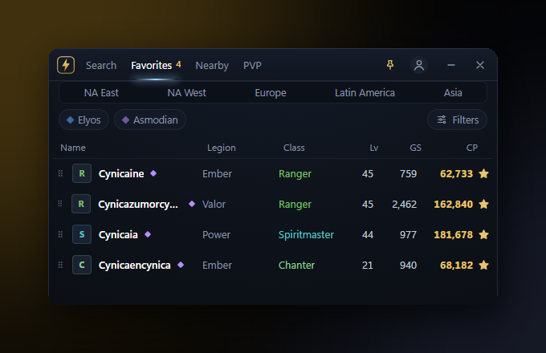

---

## Getting Started

**Windows**

1. **[Download Shugo Tracker for Windows](https://github.com/CynicaGaming/Shugo-Tracker/releases/download/v2.8.0/Shugo-Tracker-2.8.0-Windows.exe)** and put it in a folder of its own.
2. Run it. Windows may show a SmartScreen warning the first time — choose **More info → Run anyway**.
3. Play the game in **borderless windowed** mode so the tracker can sit on top.

**Android** (8.0 or newer)

1. On your phone, **[download Shugo Tracker for Android](https://github.com/CynicaGaming/Shugo-Tracker/releases/download/v2.8.0/Shugo-Tracker-2.8.0-Android.apk)**.
2. Open it. The first time, Android asks you to allow installs from your browser — allow it, then tap **Install**.

## Frequently Asked Questions

<b>Is it safe? Will it get me banned?</b>

 
Search and profiles only use NCSOFT's public website data, the same as looking someone up in a browser.
Nearby is different: it reads the game's network traffic on your own PC. It never sends, changes or injects
anything, but reading game traffic may still be against AION 2's Terms of Service. Use Nearby at your own risk;
Shugo Tracker isn't responsible for any action taken against your account.

<b>Why isn't the Android app on Google Play?</b>

 
It's installed straight from the releases here instead, like the Windows app. Android calls that an "unknown app" and asks
once before installing it; after that, updates come from inside the app (Settings → Updates).

<b>What does Share Usage Statistics send?</b>

 
Twice a day: a random id the app makes up for itself, the app version, Windows or Android and its version, the display
language, how many times a few features were used (searches, profiles opened, favorites added, Nearby turned on,
pop-outs, the PVP Log, updates), whether Nearby is on and how many favorites and own characters are saved. It never
sends character names, what you search for, your server or anything from the game, and the server keeps no IP
addresses. It's on unless you turn it off in <b>Settings → Privacy</b>; turning it off stops it at once.

<b>Why does Windows warn me when I run it?</b>

 
The exe isn't code-signed yet, so SmartScreen doesn't recognise it. The code is all here in this repository,
and every release is built automatically from it.

<b>Where are my settings and favorites?</b>

 
On Android, inside the app (uninstalling it removes them). On Windows:
in the <code>data</code>, <code>cache</code> and <code>logs</code> folders next to the exe (the <code>app</code> folder
is the program itself, unpacked the first time each version starts). Updates only replace the exe, so nothing is lost;
move or copy the whole folder to take everything with you.

<b>Why does Nearby need administrator?</b>

 
Windows only lets programs running as administrator read network traffic, and Windows Firewall has to let the
game's traffic through to it, so the first time Nearby starts, Shugo Tracker adds one firewall rule allowing
itself in ("Shugo Tracker (Nearby)"). Search, profiles and favorites never need administrator. To skip the restart each time, right-click the exe → <b>Properties</b> →
<b>Compatibility</b> → <b>Run this program as an administrator</b>. Each update gives the exe a new name (its version), so tick it again after updating.

---

  Shugo Tracker is a fan-made tool and isn't affiliated with or endorsed by NCSOFT. AION is a trademark of NCSOFT Corporation. 
  Skill descriptions courtesy of <a href="https://metabot.gg/en/aion-2/skills">MetaBot.GG</a>.

