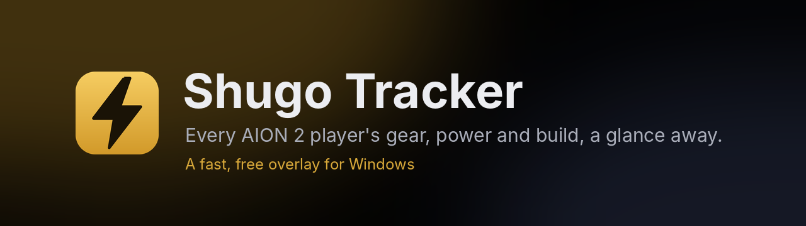
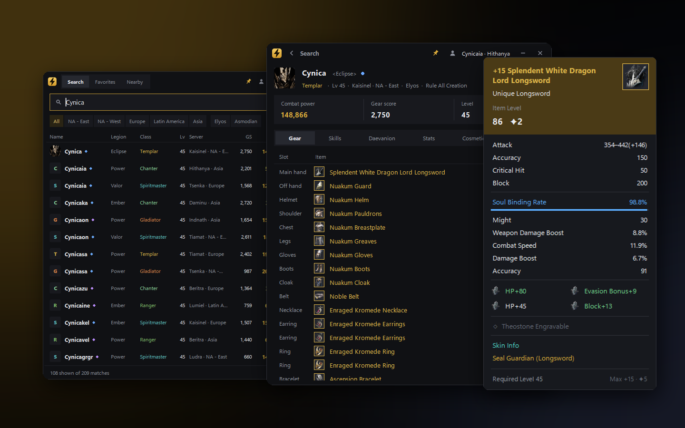
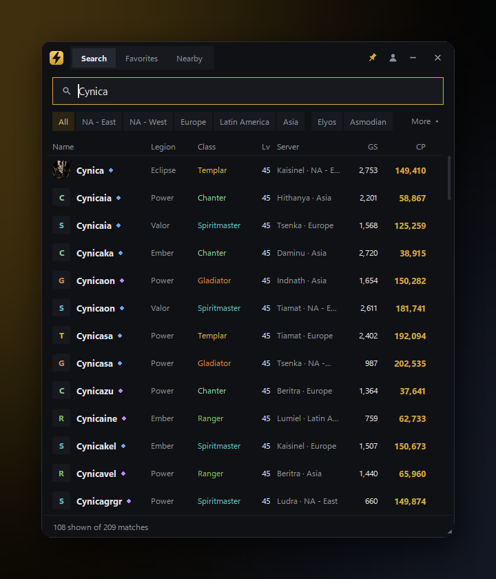
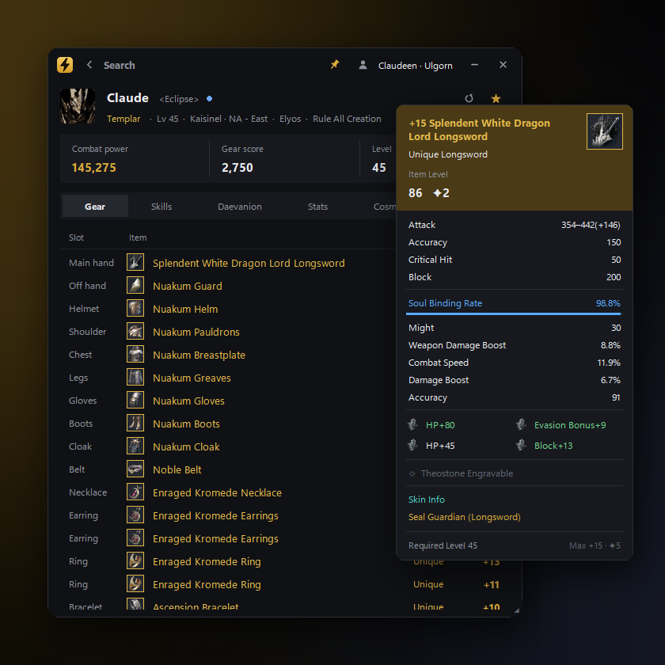
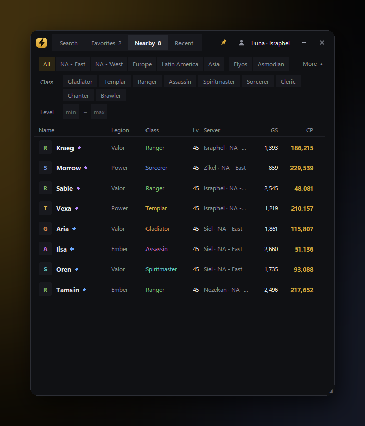
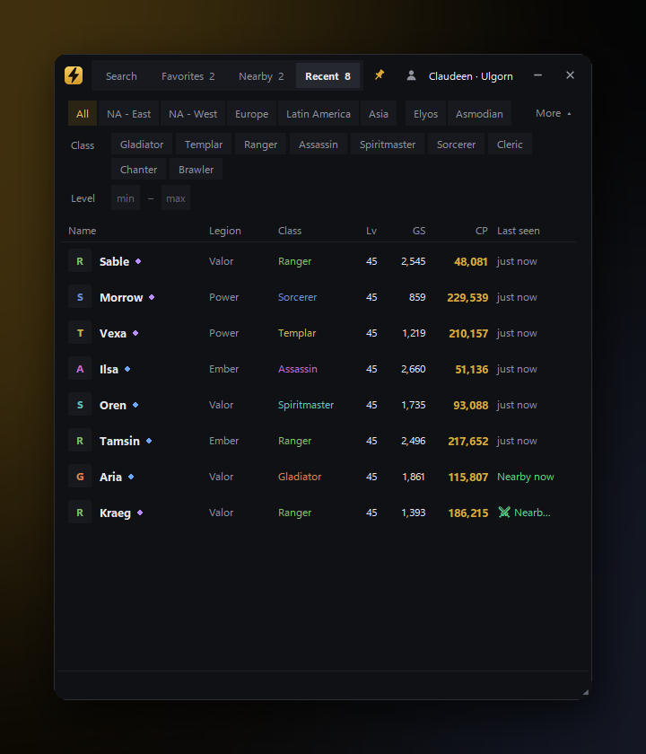
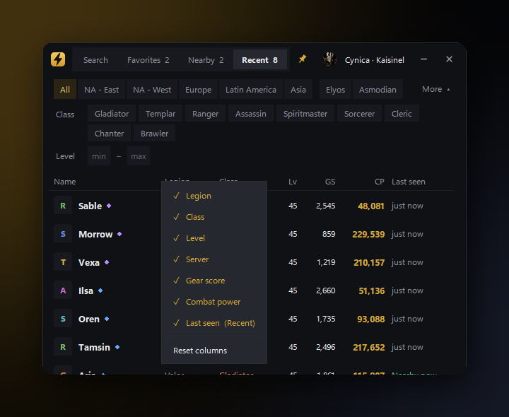
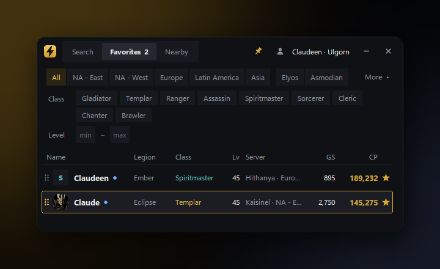

  

  
   <a href="https://github.com/CynicaGaming/Shugo-Tracker/releases/latest">Latest release notes</a>

<b>Look anyone up in a second. See exactly what they're wearing. Know who's around you.</b> 
One small, always-on-top window that sits over the game — no browser, no tabbing out.

  

---

## ✦ Find anyone, instantly

<table>
<tr>
<td width="52%"></td>
<td>

Type a name and every match across **all five Global regions** shows up while you type — with
**combat power, gear score, class, level, legion and server** right in the list.

- Filter by region, faction, class and level in one click
- Sort by any column; each tab remembers its own sort
- Show, hide and drag columns into the order you like

</td>
</tr>
</table>

## ✦ Every piece of gear, like in game

<table>
<tr>
<td>

Open a character to see their **gear, skills, Stigma, Daevanion boards, stats, appearance and titles**.

Hover any item for a tooltip laid out like the game's own: stats and enchant bonuses, soul imprint,
**mana stones, theostones**, and for Arcana cards their **linked skills and set bonuses** — with the bonuses
they actually have lit up.

</td>
<td width="52%"></td>
</tr>
</table>

## ✦ Know who's around you <code>BETA</code>

<table>
<tr>
<td width="52%"></td>
<td>

Turn on **Nearby** and the players around your character appear on their own — enemies and allies,
each with their power and gear score, in towns, in the open world, in Shugo and in the arena.

**Recent** keeps everyone you've crossed paths with for the last hour, with when you last saw them
and a ⚔ for anyone who fought you.

Opt-in. Reads the game's network traffic on your PC through Npcap; it never sends or changes anything.

</td>
</tr>
</table>

## ✦ Built for playing, not fiddling

<table>
<tr>
<td width="33%" valign="top">

**★ Favorites** 
Star friends, rivals and your legion. Drag them into your own order.

</td>
<td width="33%" valign="top">

**📌 Overlay** 
Borderless, always on top, resizable from any edge, any opacity. Works on any monitor.

</td>
<td width="33%" valign="top">

**⚡ Fast** 
Results stream in as they arrive; people you've met before load instantly.

</td>
</tr>
<tr>
<td valign="top">

**🧳 Portable** 
One exe and its folder. Copy the folder anywhere and everything comes with it.

</td>
<td valign="top">

**⬇ Updates itself** 
A green arrow appears when there's a new version: click to download, click again to restart.

</td>
<td valign="top">

**🔒 Private** 
No account, no sign-in, no tracking. Character data comes from NCSOFT's public AION 2 site.

</td>
</tr>
</table>

  
  
  

---

## Get started

1. **[Download ShugoTracker.exe](https://github.com/CynicaGaming/Shugo-Tracker/releases/latest/download/ShugoTracker.exe)** and put it in a folder of its own.
2. Run it. Windows may show a SmartScreen warning the first time — choose **More info → Run anyway**.
3. Play the game in **borderless windowed** mode so the tracker can sit on top.

For **Nearby**, install the free [Npcap](https://npcap.com/#download) (default options) and switch Nearby on.

## Good to know

<b>Is it safe? Will it get me banned?</b>

 
Search and profiles only use NCSOFT's public website data, the same as looking someone up in a browser.
Nearby is different: it reads the game's network traffic on your own PC. It never sends, changes or injects
anything, but reading game traffic may still be against AION 2's Terms of Service. Use Nearby at your own risk;
Shugo Tracker isn't responsible for any action taken against your account.

<b>Why does Windows warn me when I run it?</b>

 
The exe isn't code-signed yet, so SmartScreen doesn't recognise it. The code is all here in this repository,
and every release is built automatically from it.

<b>Where are my settings and favorites?</b>

 
In the <code>data</code>, <code>cache</code> and <code>logs</code> folders next to the exe. Updates only replace
the exe, so nothing is lost; move or copy the whole folder to take everything with you.

<b>Something's wrong with Nearby.</b>

 
In the Nearby tab, <b>Shift+click</b> the line at the bottom to record 60 seconds of game traffic into
<code>logs\diagnostics</code>, then open an issue and attach it. Game patches can change the traffic, and a
recording is what fixes it.

---

  Shugo Tracker is a fan-made tool and isn't affiliated with or endorsed by NCSOFT. AION is a trademark of NCSOFT Corporation.

